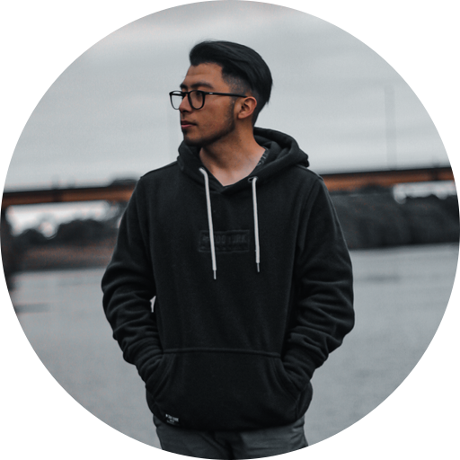
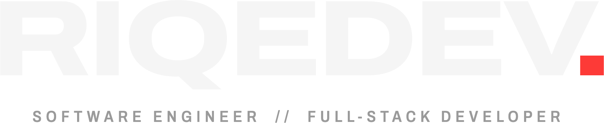
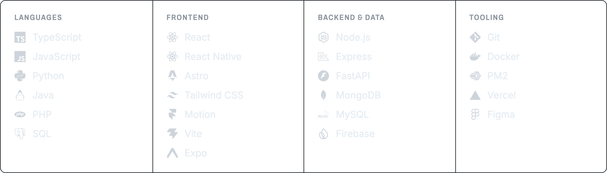

<!-- ───────────────────────  HUD HEADER (Sony α6400, como referencia)  ─────────────────────── -->

<table align="center">
<tr>
<td align="left"><code>RIQEDEV</code>&nbsp;</td>
<td align="center"><code>CHILE&nbsp;//&nbsp;38.7397°&nbsp;S,&nbsp;72.5901°&nbsp;W</code></td>
<td align="right">&nbsp;<code>AF‑C&nbsp;WIDE</code></td>
</tr>
</table>

<!-- ───────────────────────  HERO  ─────────────────────── -->

<p align="center">
  
</p>

<p align="center">
  <a href="https://riqedev.github.io">
    <picture>
      <source media="(prefers-color-scheme: dark)" srcset="./assets/wordmark-dark.png" />
      <source media="(prefers-color-scheme: light)" srcset="./assets/wordmark-light.png" />
      
    </picture>
  </a>
</p>

<p align="center">
  <code>// TAKE 01 &mdash; ENGINEERING THROUGH THE LENS</code><br/>
  
  
  
  
  
</p>

### `> tail -f /var/log/career.log`

```log
[2022-10 / 2022-12]  [LOG]   ➜ Consultant @ DIRITT UCT
    Details: Innovation workshops for secondary students.
             Mobile app prototyping, educational focus.
    > Status: COMPLETED

[2023-01 / 2023-04]  [LOG]   ➜ Dev Jr @ Kimval Ingeniería
    Details: Medical teleconsult platform. Full-stack: Java, SQL, ZK Framework.
    > Status: COMPLETED

[2023-08 / present]  [INFO]  ➜ Software Engineer @ CTR
    Details: IoT solutions, React web & React Native mobile.
             Dashboards, REST APIs, Python/Node.js backend.
    > Status: RUNNING
```

### `> cat package.json`

```json
{
  "name": "riqedev",
  "role": "Software Engineer",
  "based": "Chile",
  "dependencies": [
    "Python", "Node.js", "React", "React Native", "TypeScript",
    "Java", "PHP", "SQL", "NoSQL", "Express", "FastAPI", "Astro"
  ],
  "devDependencies": [
    "TailwindCSS", "Framer Motion", "Vite", "Expo", "Figma",
    "Git", "Docker", "Vercel", "PM2", "Firebase"
  ]
}
```

<p>
<picture>
  <source media="(prefers-color-scheme: dark)" srcset="./assets/stack-dark.png" />
  <source media="(prefers-color-scheme: light)" srcset="./assets/stack-light.png" />
  
</picture>
</p>

### `> transmission.log`

<p>
  <code>[01]</code>&nbsp;<a href="https://riqedev.github.io"></a>&nbsp;&nbsp;&nbsp;
  <code>[02]</code>&nbsp;<a href="https://riqedev-blog.vercel.app/"></a>&nbsp;&nbsp;&nbsp;
  <code>[03]</code>&nbsp;<a href="https://www.linkedin.com/in/enriquefcc/"></a>&nbsp;&nbsp;&nbsp;
  <code>[04]</code>&nbsp;<a href="https://www.flickr.com/photos/breathnshoot/"></a>
</p>

<!-- ───────────────────────  SMPTE BARS + HUD FOOTER  ─────────────────────── -->

<p></p>

<table align="center">
<tr>
<td align="left"><code>(●)&nbsp;&nbsp;1/2000&nbsp;&nbsp;F2.8&nbsp;&nbsp;±0.0&nbsp;&nbsp;ISO&nbsp;AUTO</code></td>
<td align="center"><code>BARS&nbsp;&amp;&nbsp;TONE</code></td>
<td align="right"><code>&copy;&nbsp;riqedev&nbsp;//&nbsp;END&nbsp;OF&nbsp;ROLL</code></td>
</tr>
</table>
